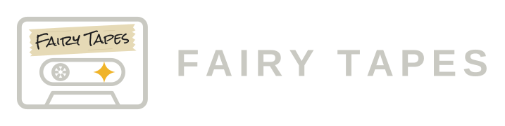

# Sweetspot Tools brand assets

Logos for [Sweetspot Tools](https://github.com/sweetspot-tools) and its products.

| Fairy Tapes |
|---|
|  |

## Folders

- `sweetspot-tools/`: the organization logo (not drawn yet).
- `fairy-tapes/`: the Fairy Tapes suite of audio plug-ins. See [fairy-tapes/README.md](fairy-tapes/README.md).

Each folder holds the generated files and, in `tools/`, the script that generates them.

## License

The logos are licensed under [CC BY-ND 4.0](LICENSE) (Creative Commons Attribution-NoDerivatives 4.0 International). Copyright (c) 2026 swolley.

You may share them, unmodified, for any purpose, including commercial, with attribution. You may not distribute modified versions.

The generator scripts in the `tools/` folders are part of this repository and under the same license.

## Names and trademarks

"Sweetspot Tools", "Fairy Tapes" and the logos identify this project. The CC license does not grant any trademark rights. Forks, derivative products and services must not use these names or logos in a way that suggests they are the official project or are affiliated with it.

The code of the Sweetspot Tools repositories is licensed separately (Fairy Tapes: GPL-3.0, see each repository). This license applies only to the files in this repository.

## Using a logo in a README

```html

```
